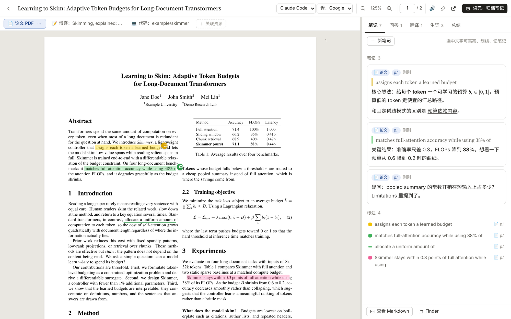
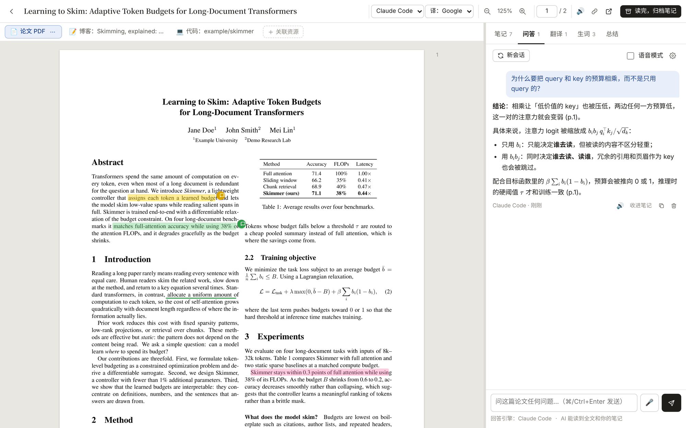
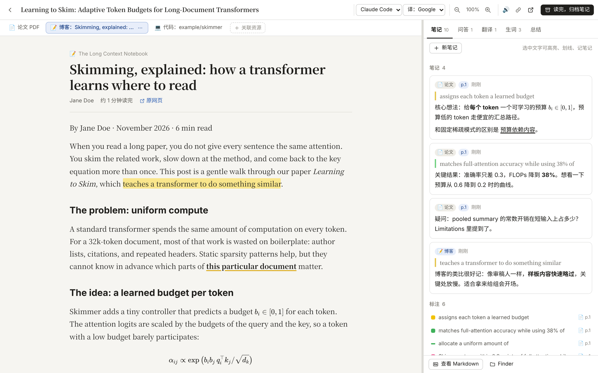
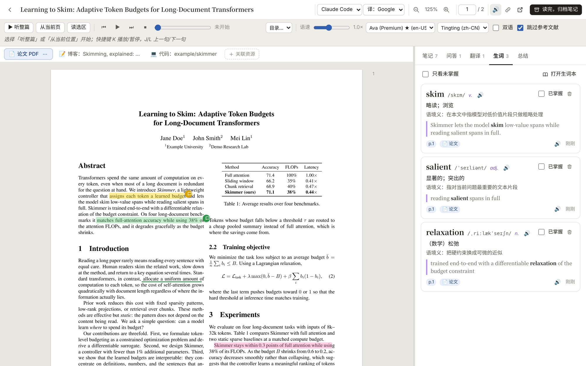
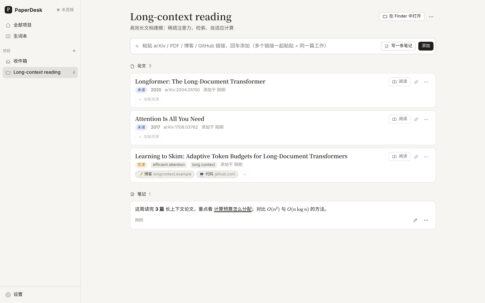
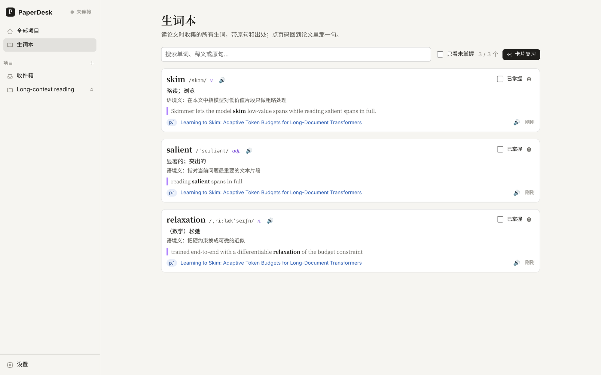
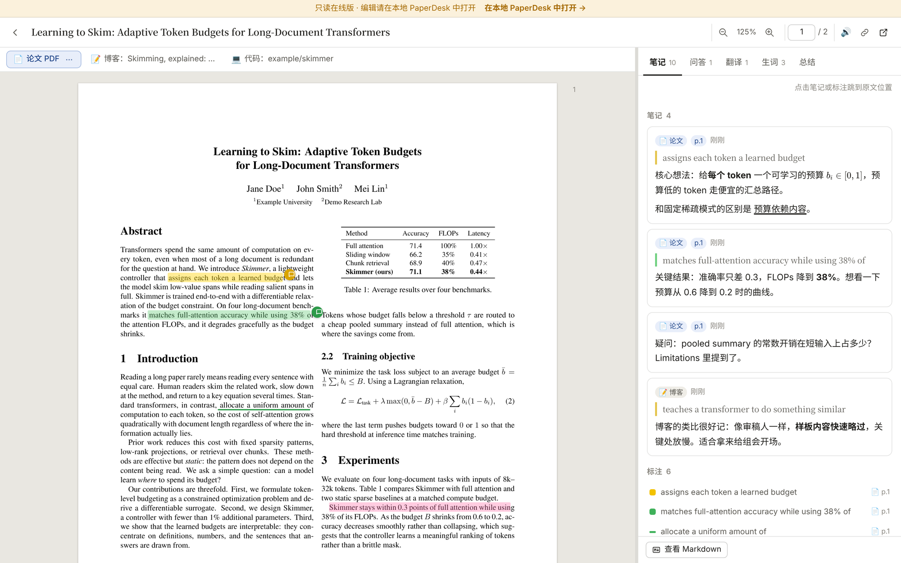

# PaperDesk：不下载 PDF 的论文阅读台

PaperDesk 是一个跑在你自己 Mac 上的小网页应用。它把读论文要用到的几件事放在同一个页面里：



- **打开论文不用下载 PDF**：粘贴 arXiv ID、arXiv 链接、OpenReview 链接或任意 PDF 链接就能读。
- **博客、网页也能直接读**：自动抽出正文（去掉导航、侧栏、评论），图片、代码块、公式都保留；GitHub 仓库直接显示 README。翻译、提问、标注、笔记、生词、朗读和 PDF 完全一样。
- **一篇工作的所有资源放在一起**：论文、代码、项目主页、博客、视频、模型 / 数据集挂在同一个条目下，阅读页一键切换，笔记和问答共用；arXiv 摘要里的代码和主页链接会被自动发现。
- **边读边翻译**：划词翻译，也能整页按段落中英对照翻译。
- **边读边问 AI**：直接调用你电脑上已经登录的 **Claude Code**（`claude`）或 **Codex**（`codex`）。每篇论文有自己的会话，下次打开还能接着问。
- **随手标注和记笔记**：5 种颜色的高亮，加上下划线、删除线、波浪线和批注。笔记支持 Markdown（**加粗**、<ins>下划线</ins>、公式 $\sqrt{d_k}$、列表、引用）。
- **朗读**：用 macOS 自带的语音读选中的句子或整页，读到哪一句就高亮哪一句。
- **语音模式**：像听有声书一样听完整篇论文（可中英双语），也可以直接开口问 Claude Code / Codex，它边想边用语音回答。
- **生词本**：双击单词点「生词」，自动查音标、词性、释义和它在这句话里的意思。全库生词可以统一复习。
- **读完一键归档**：Agent 把你的笔记、标注、问答和论文全文整理成一份结构化的中文总结。
- **项目文件夹**：每个项目一个文件夹，可以放论文、博客 / 网页、代码仓库和文字笔记。
- **整个文献库同步到 GitHub**：项目、笔记、问答、总结和生词都是 Markdown + JSON，改动后会自动 commit 并 push。
- **每篇论文一个固定网址**：`http://localhost:8765/r/<项目>/<论文>`。打开就回到这篇论文，PDF、高亮和笔记都在原来的位置。

## 截图

| | |
|---|---|
|  |  |
| **问答**：直接问本机的 Claude Code / Codex，回答带公式和页码 | **博客 / 网页**：同一篇工作的博客、主页、代码 README 在资源栏里切换 |
|  |  |
| **生词 + 听整篇**：查词、复习，或者把整篇论文读给你听 | **项目文件夹**：一个条目挂多个资源，笔记支持加粗、下划线、公式 |
|  |  |
| **生词本**：全库生词统一复习，点一下回到原文 | **在线只读版**：同步到 GitHub Pages 后，在任何地方都能看 |

> 截图都是真实界面，用的是演示数据：论文 *Learning to Skim* 和那篇博客都是为演示原创的虚构内容。截图由 [`scripts/make_screenshots.py`](scripts/make_screenshots.py) 自动生成，可以重新跑一遍。

---

## 目录

- [截图](#截图)

1. [为什么说「不下载 PDF」](#1-为什么说不下载-pdf)
2. [前置条件](#2-前置条件)
3. [安装与一键启动](#3-安装与一键启动)
4. [项目文件夹怎么用](#4-项目文件夹怎么用)（含 [4.1 博客 / 网页与多资源](#41-博客--网页以及一篇工作的多个资源)）
5. [阅读页：划词工具条、标注、笔记](#5-阅读页划词工具条标注笔记)
6. [笔记的 Markdown 写法](#6-笔记的-markdown-写法)
7. [翻译与问答：引擎怎么选](#7-翻译与问答引擎怎么选)
8. [朗读](#8-朗读)
9. [生词本](#9-生词本)
10. [语音模式：听整篇论文 + 语音对话](#10-语音模式听整篇论文--语音对话)
11. [读完归档](#11-读完归档)
12. [连接 GitHub：文献库同步](#12-连接-github文献库同步)
13. [每篇论文的固定链接，以及从 GitHub 跳回来](#13-每篇论文的固定链接以及从-github-跳回来)
14. [在终端里的 Claude Code / Codex 中使用（MCP）](#14-在终端里的-claude-code--codex-中使用mcp)
15. [数据目录结构](#15-数据目录结构)
16. [隐私说明](#16-隐私说明)
17. [把代码本身放到 GitHub](#17-把代码本身放到-github)
18. [常见问题](#18-常见问题)

---

## 1. 为什么说「不下载 PDF」

严格来说，任何阅读器要把 PDF 显示出来，都得先把它的字节拉到电脑上。你在浏览器里点开 `arxiv.org/pdf/...` 也是这样。PaperDesk 说的「不下载」是指：**PDF 永远不会变成你硬盘上一个需要你管理的文件。**

具体做法是这样的：

1. 你只提供一个链接或 arXiv ID。
2. 本地后端去 arXiv（或别的网站）拉 PDF，**每次读 64KB 就立刻转给浏览器**，不写磁盘，也不做缓存。
3. 浏览器里的 pdf.js 在**内存**里渲染。关掉页面，PDF 就没了。
4. 真正保存下来的只有**你自己的东西**：笔记、标注位置（页码 + 归一化坐标 + 原文片段）、问答、翻译、生词、总结，以及论文的链接和元数据。
5. 下次打开时用链接重新拉一遍 PDF，再把你的标注按坐标画回原位。

有一个例外需要说明：为了让 Claude Code / Codex 能「读」论文，阅读页打开时会把 pdf.js 抽出的**纯文字**存进数据目录下的 `.cache/text/`。这只是文字，不是 PDF，也**不会上传到 GitHub**（`.gitignore` 已排除），可以随时删掉。

---

## 2. 前置条件

| 需要 | 用途 | 检查方法 |
|---|---|---|
| **python3**（3.9+） | 运行后端（只用标准库，**不用 pip 装任何东西**） | `python3 --version`；没有就运行 `xcode-select --install` |
| **claude**（Claude Code CLI，已登录） | 问答、解释、归档总结，也可以用来翻译和查词 | `claude --version`，然后在终端里运行一次 `claude` 确认已登录 |
| **codex**（Codex CLI，已登录），可选 | 另一种问答引擎 | `codex --version`；`codex login` |
| **git** | 文献库自动同步到 GitHub | `git --version` |
| **gh**（GitHub CLI），可选 | 一键创建 GitHub 仓库 | `gh auth status`；没有就 `brew install gh && gh auth login` |
| 现代浏览器 | Chrome / Safari / Arc / Edge 都可以 | 朗读功能在 Safari 和 Chrome 里的 macOS 语音最好 |

`claude` 和 `codex` 至少要有一个。没有的那个在界面里会显示为不可用。

---

## 3. 安装与一键启动

1. 把代码克隆到你喜欢的位置（代码仓库：<https://github.com/mkj69/paperdesk>）：
   ```bash
   mkdir -p ~/tools && cd ~/tools
   git clone https://github.com/mkj69/paperdesk.git
   ```
   以后更新代码只要在这个目录里 `git pull`。不想用 git 也可以直接下载 zip 解压。
2. **双击 `PaperDesk.command`**。它会打开一个终端窗口，启动服务，然后自动在浏览器里打开 `http://localhost:8765`。
   - 如果服务已经在运行，它只会帮你打开浏览器。
   - 关掉那个终端窗口或按 `Ctrl+C`，服务就停了。
3. **第一次双击时 macOS 可能提示「无法验证开发者」**，这是因为文件是从网上下载的。解决办法二选一：
   - 在 Finder 里**右键 → 打开 → 打开**，只需要做一次；
   - 或者在终端里运行：
     ```bash
     xattr -d com.apple.quarantine ~/tools/paperdesk/PaperDesk.command
     chmod +x ~/tools/paperdesk/PaperDesk.command
     ```

也可以用终端启动：

```bash
cd ~/tools/paperdesk
./start.sh                       # 等价于 python3 server.py --port 8765
python3 server.py --port 8765 --data ~/PaperDesk-Library --no-browser
```

| 参数 / 环境变量 | 作用 | 默认值 |
|---|---|---|
| `--port` / `PAPERDESK_PORT` | 端口 | `8765` |
| `--data` / `PAPERDESK_HOME` | 文献库（数据目录）位置 | `~/PaperDesk-Library` |
| `--no-browser` | 启动时不自动打开浏览器 | 自动打开 |
| `--clone <仓库地址>` | 数据目录不存在或为空时，先把已有的文献库 `git clone` 下来再启动（换电脑用） | 不克隆 |

服务只监听 `127.0.0.1`，局域网里的其他设备访问不到。

> 想开机自动启动？可以把 `PaperDesk.command` 加到「系统设置 → 通用 → 登录项」里。

---

## 4. 项目文件夹怎么用

- 左侧栏是**项目列表**。第一次启动会自动建一个「收件箱」。点「新建项目」可以按研究方向、课程或某篇论文的写作来建文件夹。
- 进入项目页后，顶部有一个输入框，**粘贴什么都行**：
  - `1706.03762`、`2406.12345v2`、`hep-th/9901001` 这类 arXiv ID，或者 `arxiv.org/abs|pdf|html/...` 链接，会识别成**论文**，并自动拉取标题、作者、年份和摘要；
  - `openreview.net/forum?id=...` 会识别成**论文**，自动换成对应的 PDF 地址；
  - 以 `.pdf` 结尾，或服务器返回 PDF 类型的链接，也是**论文**；
  - 其他网页（博客、项目主页、GitHub 仓库……）是**网页**条目，点「阅读」在阅读页里打开，见下面的 4.1；
  - **一次粘贴多个链接**（换行或空格分开），比如论文 + 代码 + 博客，会合成**一个条目**：第一个论文链接当主链接，其余挂成资源；
  - 旁边的「写一条笔记」会建一个**文字笔记**条目，内容是 Markdown。
- 每个条目都可以改标题和标签，标记「未读 / 在读 / 读完」，**移动到别的项目**，或者删除。删除的东西会进数据目录下的 `.trash/`，不会立刻消失。
- 「在 Finder 中打开」可以直接打开这个项目的文件夹，里面就是 Markdown 笔记。

### 4.1 博客 / 网页，以及一篇工作的多个资源

**网页阅读器**：网页条目（或某个条目下的博客、主页资源）在阅读页里打开时，PaperDesk 会抓取网页、只留下正文，排成适合阅读的版式：

- 自动去掉导航栏、侧栏、页脚、评论、分享按钮、订阅框这类噪声；
- 图片（包括懒加载的图片）、代码块、表格、引用都保留，相对链接会被补成完整地址；
- 公式：MathJax / KaTeX 写的公式会被还原成 TeX，再用 KaTeX 渲染；
- GitHub 仓库链接直接显示渲染好的 **README**，顶部有仓库描述、star 数和语言；
- 视频（YouTube / Bilibili）嵌入播放，可以边看边记笔记；
- 正文抽不出来时（比如完全靠 JavaScript 渲染的页面），会提示你「在新标签页打开原网页」，也可以试试 iframe 嵌入（有些网站会拒绝）。

划词工具条在网页里和 PDF 里完全一样：翻译、解释、问 Agent、记一笔、5 色高亮、下划线、删除线、波浪线、朗读、生词。网页标注按「原文 + 前后文」定位，重新打开时会还原到原来的位置。网页也同样不落盘。

**一篇工作的多个资源**：每个条目除了主链接，还可以挂任意多个资源，类型自动识别：

| 图标 | 类型 | 例子 |
|---|---|---|
| 📄 | 论文 | arXiv、OpenReview、PDF 链接 |
| 💻 | 代码 | github.com、gitlab.com |
| 🏠 | 主页 | 项目主页、`*.github.io` |
| 📝 | 博客 | Medium、Substack、Distill、路径里带 `/blog/` `/posts/` |
| 🎬 | 视频 | YouTube、Bilibili、Vimeo |
| 🤗 | 模型 / 数据集 / Demo | huggingface.co |
| 🖼️ | 幻灯片 | Speaker Deck、Google Slides、`.pptx` |

- 加资源的方式：项目页卡片上的「＋关联资源」、阅读页资源栏最右边的「＋」，或者添加条目时一次粘贴多个链接。类型认错了可以手动改。
- **自动发现**：arXiv 论文摘要和备注里出现的 GitHub 链接、项目主页、Hugging Face 模型会被自动挂上（标记为「自动」）；添加一个 GitHub 仓库时，README 里提到的 arXiv 论文也会被挂上。
- 阅读页左上角的**资源栏**可以在论文 PDF、博客、主页、代码 README 之间切换（地址栏会记住 `?res=…`）。右侧的笔记、问答、翻译、生词、总结是这篇工作**共用**的，每张卡片都标明来自哪个资源，点一下就切过去并闪烁原文位置。
- 问 Claude Code / Codex 时，它能同时读到论文全文、博客正文和 README。
- 导出到 GitHub 的笔记顶部有一行「**相关资源**」：📄 论文 · 💻 代码 · 🏠 主页 · 📝 博客……

---

## 5. 阅读页：划词工具条、标注、笔记

阅读页左边是 PDF（连续滚动，`−` / `+` 缩放，会记住上次读到第几页），右边是面板，分 **笔记｜问答｜翻译｜生词｜总结** 几个标签。

在 PDF 上**选中文字**，会弹出划词工具条：

| 按钮 | 作用 |
|---|---|
| **翻译** | 翻译选中内容，结果进「翻译」标签，可以一键收进笔记 |
| **解释** | 让 Agent 结合上下文解释这段话（公式会逐项拆开讲） |
| **问 Agent** | 把选中内容作为引文放进提问框，你再补充问题 |
| **记一笔** | 打开笔记编辑器，自动带上引文和页码 |
| **高亮** | 5 种颜色：黄、绿、蓝、粉、紫 |
| **下划线 / 删除线 / 波浪线** | 另外三种标注样式 |
| **朗读** | 朗读选中的内容 |
| **生词** | 加进生词本（见第 9 节） |

点击已有的标注，可以改颜色或类型、写批注、删除。有批注的标注旁边会出现一个小气泡。

**再次打开时**：标注按页码和归一化坐标画回原位，不受缩放影响。右侧笔记按页码排好，点一下就跳到对应页，相应标注会闪一下。

---

## 6. 笔记的 Markdown 写法

笔记编辑器顶部有工具栏：**B**（加粗）、*I*（斜体）、<ins>U</ins>（下划线）、`code`、∑（公式）、列表、引用。可以切换预览，`Cmd+Enter` 保存。

| 效果 | 写法 | 说明 |
|---|---|---|
| **加粗** | `**加粗**` | |
| *斜体* | `*斜体*` | |
| <ins>下划线</ins> | `<ins>下划线</ins>` | 用 `<ins>` 而不是 `<u>`，因为 GitHub 网页能正确显示 `<ins>` |
| `行内代码` | `` `code` `` | |
| 行内公式 | `$\sqrt{d_k}$` | KaTeX 渲染 |
| 独立公式 | `$$\mathrm{softmax}(QK^T/\sqrt{d_k})V$$` | |
| 引用 | `> 原文……` | |
| 列表 | `- 要点` | |

存进 `.md` 文件的就是这些 Markdown 原文。在 GitHub 网页上看笔记，加粗、下划线和公式都能正常显示（GitHub 支持 `$…$` 数学公式）。

---

## 7. 翻译与问答：引擎怎么选

阅读页顶栏有两个下拉框，设置页里也能改默认值：

- **问答引擎**：`Claude Code` 或 `Codex`。用于「解释」「问 Agent」和「归档」。
- **翻译引擎**：`Google`（默认）、`Claude` 或 `Codex`。

为什么翻译默认用 Google？

- 划词翻译用得非常频繁，要快。Google 的免费接口通常不到一秒就返回。
- **从 2026-06-15 起，订阅计划下 `claude -p`（也就是 Agent SDK）的用量，计入单独的每月 Agent SDK 额度**，和你在终端里交互式使用 Claude Code 的额度分开算。PaperDesk 调用 Claude 走的正是 `claude -p`。如果每次划词都用 Claude 翻译，这个额度会消耗得很快。
- 所以推荐：**翻译用 Google，真正需要理解的问题再问 Claude / Codex**。想要更地道的学术译文时，可以临时把翻译引擎切到 Claude。设置里 `claude_translate_model` 默认是 `haiku`，又快又省。

问答的工作方式：

- 每篇论文在数据目录下有一个 Agent 工作目录（`.agent/...`），里面放着 `paper.txt`（带 `[p.N]` 页码标记的全文）、`notes.md`（你当前的笔记）以及说明文件（`CLAUDE.md` / `AGENTS.md`）。
- Claude Code 只开放 `Read, Grep, Glob` 三个只读工具，Codex 用 `--sandbox read-only`。它们**只能读、不能改**任何文件。
- 每篇论文的会话 id 会保存下来（Claude 用 `--resume`，Codex 用 `exec resume`），下次打开还能接着问。想重新开始就点「新会话」。
- 回答里引用原文时会标注 `(p.N)`。每条回答都可以「收进笔记」。

---

## 8. 朗读

朗读用浏览器自带的 Web Speech API。在 Mac 上它直接调用系统语音，**免费、离线、不需要任何账号**。

- 阅读页顶栏点「朗读」，会出现一个小播放条：**朗读选区 / 从当前页开始 / 暂停 / 继续 / 停止**，语速可以在 0.6–1.6 之间调。
- 「从当前页开始」会逐句朗读，正在读的句子在 PDF 上高亮。读完一页会自动翻到下一页。
- 可以分别选英文和中文语音。英文推荐 Samantha、Ava 或带 *Enhanced* / *Premium* 的语音。翻译和译文用中文语音读。
- 翻译条目、问答回答和生词卡片上都有 🔊 小按钮。
- **想要更自然的语音**：打开「系统设置 → 辅助功能 → 朗读内容 → 系统语音 → 管理语音…」，下载 *Ava (Premium)* 或 *Zoe (Premium)* 之类的高质量英文语音，以及中文的 *Tingting* 等。下载后刷新 PaperDesk 就能选。
- 语速和语音选择保存在浏览器里，下次自动沿用。
- 想把**整篇论文**从头听到尾（自动跳过参考文献、双语朗读、媒体键控制），或者**直接开口问 AI**，见第 10 节「语音模式」。

---

## 9. 生词本

- 在 PDF 上**双击一个单词**（也可以选中 6 个词以内的短语），工具条上点 **生词**：
  1. 这个词会被标上紫色点状下划线；
  2. 后台查词，得到**音标、词性、中文释义**，再结合原句给出**在这篇论文里的意思**和**原句翻译**。
- 查词引擎在设置里选（`vocab_engine`）：
  - `google`（默认，免费、快）：释义和词性来自 Google 翻译的词典结果，音标来自 dictionaryapi.dev；
  - `claude` / `codex`：让模型输出结构化 JSON，**语境义更准**，但会消耗额度。
- 查词失败也会保存这个词，可以之后手动补释义。同一篇论文里重复加同一个词，不会重复建条目，只会追加新的原句。
- 阅读页的 **生词** 标签显示本篇的生词卡片：单词、音标、🔊、释义、原句（单词加粗，点页码能跳回去），可以勾选「已掌握」。
- 左侧栏的 **生词本**（`/vocab`）汇总全库生词，支持搜索和「只看未掌握」，还有**卡片复习模式**：先只显示单词，点一下翻出释义，然后选「认识 / 不认识」。每个词都能跳回出处论文的那一页。
- 文件层面：每篇论文的 `.md` 里有「## 生词」表格；数据目录根部的 `vocabulary.md` 汇总全库生词（按字母分组，已掌握的放最后，每条附出处链接）。所以在 GitHub 上也能直接复习。

---

## 10. 语音模式：听整篇论文 + 语音对话

语音模式有两部分：**听**（把整篇论文当有声书听）和**说**（开口提问，Claude Code / Codex 用语音回答）。两者可以配合使用：听到一半有疑问，直接问，答完它会接着往下读。

### A. 听整篇论文（有声书模式）

点阅读页顶栏的「朗读」打开播放条，再点 **「听整篇」**：

- **从哪里开始**：第一次从第 1 页开始；之后默认「从上次位置继续」。读到哪一页、哪一句会保存在这篇论文的状态里（`tts_pos`），换浏览器或重启电脑也不会丢。
- **读之前会先清洗文字**，让朗读听起来像在读文章，而不是在读 PDF：
  - 把 PDF 里断开的行和碎片拼回完整的句子，`trans-` + `former` 断词会合并成 `transformer`；
  - 去掉每页重复的页眉、页脚和孤立页码；
  - 去掉 `[12]`、`[3, 7]` 这类引用标记；
  - 符号很密的公式行读成「（公式略）」，不会逐个念字符；
  - **默认跳过参考文献和附录**：读到 *References* / *Bibliography* / 参考文献 标题就停。播放条里可以关掉这个选项。
- **逐句朗读**，当前句在 PDF 上高亮，页面自动跟着滚动。播放条显示「第 N/M 页 · 第 k 句」，进度条可以拖动跳转。还有一个**章节下拉**：优先用 PDF 自带的目录；没有目录时，用识别出的标题行（如 *1 Introduction*、*3.2 Method*）生成。
- **双语朗读**开关：每读完一句英文，接着用中文语音读这句的译文。译文按段落提前取好并缓存，不会卡顿。翻译用的是当前的翻译引擎，默认 Google。
- **快捷键**（焦点不在输入框时）：

  | 键 | 作用 |
  |---|---|
  | `K` | 播放 / 暂停（空格留给页面滚动） |
  | `J` | 上一句 |
  | `L` | 下一句 |

- **媒体键 / 控制中心**：PaperDesk 通过 Media Session API 注册了论文标题和作者。Mac 键盘上的 ⏯ ⏮ ⏭、耳机线控和「控制中心」的正在播放卡片都能控制它。浏览器切到后台、你去看别的窗口时也能用。

### B. 语音对话（Voice mode）

问答标签输入框旁边有 **🎤** 按钮和「语音模式」开关。打开语音模式后，阅读页右下角会出现一个**语音球**，显示当前状态：聆听中 / 思考中 / 回答中。

**怎么说话：**

- **点 🎤**：开始或停止聆听；
- **按住 ⌥ Option 说话，松开就发送**（push-to-talk）。这和 Claude Code 里「按住说话」的习惯一致；
- 识别语言可以选 **中文（zh-CN）** 或 **English（en-US）**。说话时会实时显示转写的文字。

**说出来的话怎么处理：** 先匹配下面这些**本地语音指令**（中英文都认几种说法），匹配上就直接执行，不打扰 AI：

| 你说 | 效果 |
|---|---|
| 「朗读」「读一下」「开始读」/ *read* | 从当前位置开始朗读 |
| 「暂停」「停」/ *pause*, *stop* | 暂停朗读 |
| 「继续」/ *continue*, *resume* | 继续朗读 |
| 「下一页」「上一页」/ *next page*, *previous page* | 翻页 |
| 「翻译这句」「翻译这段」/ *translate this* | 翻译当前在读的句子（或当前选区），并用中文读出来 |
| 「记下来 ……」「记一下 ……」/ *note ……* | 把后面说的内容存成当前页的笔记，并引用当前句 |
| 「生词 xxx」「加入生词 xxx」/ *add word xxx* | 把 xxx 加进生词本 |
| 「结束语音模式」「退出语音」/ *exit voice* | 关闭语音模式 |

不是指令的话，就当成**问题**发给当前的问答引擎（Claude Code 或 Codex）：

- 自动带上上下文：当前选中的文字或正在朗读的句子会作为引文，当前页码也一并传过去；
- 会要求 AI **用口语回答**：2–6 句，先说结论，不用表格、代码块和标题，公式用口头描述；
- 回答一边流式显示在问答历史里，一边**按句读出来**。朗读前会去掉 Markdown 符号，公式会转成口语，比如 `$\sqrt{d_k}$` 读成「根号 d k」，`x^2` 读成「x 平方」，`W_k` 读成「W 下标 k」；
- 语音提问的记录在问答历史里有标记（`style: voice`），归档总结时也会被整理进去。

**连续对话（免手动）**：打开后，回答读完会自动再次开始聆听，可以一直聊下去。

- 播报时识别会暂停，避免把自己的声音当成你在说话；
- **随时打断**：点一下语音球或直接开口，就会停止播报，开始听你说。

**和听论文联动**：朗读时你开口提问，朗读会暂停。回答完之后，如果打开了「答完继续朗读」，就从刚才停下的地方继续往下读。

### C. 为什么不直接用 Claude Code 的 /voice 或 Codex 的语音？

- **Claude Code 的 `/voice`** 是终端里的语音输入（按住说话、转成文字），只在终端会话里有效；
- **Codex** 的语音功能在它的桌面 App 里，命令行版本已不再提供语音输入。

它们都是各自界面自带的听写或语音功能，**没法嵌进一个网页**，也拿不到你正在读的这篇论文、这一页、这一句。所以 PaperDesk 自己搭了一套效果相同的链路：

```
浏览器语音识别（你的声音 → 文字）
      ↓
你本机已登录的 claude / codex（大脑：读 paper.txt、notes.md，延续这篇论文的会话）
      ↓
macOS 系统语音播报（文字 → 声音）
```

好处是语音提问和打字提问用的是**同一个会话**，上下文是同一篇论文，记录也存在同一个问答历史里。

### D. 浏览器要求与设置

- **推荐 Chrome、Edge 或 Safari。** Firefox 不支持网页语音识别，会提示你换浏览器，但「听整篇」照样能用。
- **隐私提示**：**Chrome / Edge 的语音识别会把音频发到 Google / Microsoft 的服务器**转写；Safari 用的是 Apple 的语音识别。介意的话就只用「听」，提问用打字。朗读（TTS）全部用本机系统语音，不联网。
- **第一次点 🎤 时，浏览器会请求麦克风权限**，点「允许」。不小心点了拒绝：在地址栏左边的站点设置里把 `localhost` 的麦克风改成允许；或者打开「系统设置 → 隐私与安全性 → 麦克风」，给浏览器开权限。
- **想要更自然的声音**：打开「系统设置 → 辅助功能 → 朗读内容 → 系统语音 → 管理语音…」，下载带「优化」（Enhanced）或「高级」（Premium）字样的语音，比如英文的 *Ava (Premium)*、*Zoe (Premium)*、*Samantha (Enhanced)*，中文的 *Tingting*、*Lilian* 等。下载后刷新 PaperDesk，在播放条的语音选择里就能看到。
- 语速、语音、识别语言、各个开关都保存在浏览器里，下次自动沿用。

---

## 11. 读完归档

点阅读页右上角的 **「读完，归档笔记」**：

1. Agent 读取论文全文、你的笔记、标注、问答和生词；
2. 流式生成一份中文总结，大致包括：一句话总结、问题与动机、方法、关键结果、我的笔记要点、我问过的问题、局限与疑问、和我研究的关联、后续可读；
3. 总结写进这篇论文的 `.md` 文件顶部，状态改为「读完」，并触发一次 GitHub 同步。

不满意可以再点一次重新生成，会覆盖旧的总结。

---

## 12. 连接 GitHub：文献库同步

**文献库**指数据目录（默认 `~/PaperDesk-Library`），它本身就是一个 git 仓库。第一次启动时会自动 `git init`。每次改动后（默认防抖 30 秒），PaperDesk 会在后台执行：

```
git add -A → git commit -m "PaperDesk: …" → git pull --rebase --autostash → git push
```

左侧栏的小圆点表示同步状态：绿色是已同步，黄色是待同步，红色是出错（点开能看原因），灰色是还没连接远程仓库。

**公开还是私有都可以。** 仓库里只有你的笔记、问答、总结、生词和论文链接，**没有 PDF，也没有论文全文**。所以公开也没问题，还能顺便当成「公开读书笔记」。如果笔记里有还没发表的想法，就选私有。

### 方式 A：在 PaperDesk 里一键创建（需要 gh）

1. 在终端里确认 `gh auth status` 已登录。没有的话先运行 `brew install gh && gh auth login`。
2. 点左侧栏的同步圆点，打开同步面板，选「创建新仓库」，填仓库名（比如 `paper-library`），选**公开 / 私有**，点创建。
3. 背后执行的是 `gh repo create paper-library --public|--private --source <数据目录> --remote origin --push`。

### 方式 B：连接已有的空仓库

1. 在 <https://github.com/new> 建一个**空**仓库，不要勾选 README。
2. 在同步面板选「连接已有仓库」，填 SSH 地址，比如 `git@github.com:<你的用户名>/paper-library.git`，或者 HTTPS 地址。
3. 要求你本机的 git 已经能推送到 GitHub：SSH key 已配置，或者装了 gh / Git Credential Manager。PaperDesk 不会弹出密码框（`GIT_TERMINAL_PROMPT=0`），认证失败会显示成红点和错误信息。

### 换电脑 / 多台电脑一起用

新电脑上只要三步：

1. `git clone https://github.com/mkj69/paperdesk.git ~/tools/paperdesk`（代码）
2. 双击 `PaperDesk.command`
3. 打开同步面板 →「连接已有仓库」→ 填文献库地址（比如 `git@github.com:mkj69/paper-library.git`）

PaperDesk 发现新电脑上的文献库还是空的，就会**直接采用远端的文献库**：所有项目、笔记、标注、问答、生词都拉下来，然后重新生成 Markdown 和在线只读站。也可以一步到位：

```bash
python3 server.py --clone git@github.com:mkj69/paper-library.git
```

两台电脑都在写也没关系。每次同步时先 `fetch`，远端有新提交就合并：数据文件（`project.json`、`papers/*.json`）**按条目 id 合并**，同一条以较新的修改为准，一边删除、另一边没改过的条目会被删掉；README、论文 `.md`、生词本、在线只读站这类自动生成的文件直接重新生成，不会出现冲突标记。

跟具体电脑有关的设置（`claude_path`、`codex_path`）存在不上传的 `settings.local.json` 里，每台电脑各自一份。

### 在线只读版（GitHub Pages）

记笔记、标注、问 AI 都在本地 PaperDesk 里做；**只是看的话，用 GitHub 的静态网页就够了**。PaperDesk 每次同步都会把一个**只读版阅读器**一起导出到文献库根目录（`index.html`、`static/`、`library.json`、`vocabulary.json`、`.nojekyll`）。

开启方法（只需一次）：

- 装了 gh：同步面板里点「开启 GitHub Pages」；
- 或者手动：GitHub 仓库 → Settings → Pages → Source 选 **Deploy from a branch**，分支 `main`，目录 `/ (root)`。

之后 `https://mkj69.github.io/paper-library/` 就是你的在线文献库：项目文件夹、论文列表、每篇论文的阅读页（PDF + 高亮 / 下划线 + 笔记 + 问答 + 总结）、生词本都能看，也能用朗读和听整篇。写操作、AI、翻译、同步和设置都隐藏了，顶部有「在本地 PaperDesk 中编辑」的跳转链接。地址格式是 `…/#/r/<项目>/<论文>`。

PDF 的显示方式：在线版会先尝试直接从 arXiv 加载 PDF，能加载就把高亮精确叠加上去。如果源站不允许别的网站跨域读取，就退一步用浏览器自带的 PDF 查看器显示原文，点哪条笔记就跳到对应的页。本地版不受这个限制。

GitHub Pages 对私有仓库需要付费计划（学生可以通过 GitHub Student Developer Pack 免费获得 Pro）。公开仓库免费。

---

## 13. 每篇论文的固定链接，以及从 GitHub 跳回来

- 每篇论文都有固定网址：`http://localhost:8765/r/<项目 id>/<条目 id>`。项目页的论文卡片上有「复制阅读链接」，阅读页顶栏也有。
- 这个链接可以放进书签、Notion、Obsidian 或者你自己的笔记里。只要 PaperDesk 在运行，点开就直接进入这篇论文：PDF 重新流式加载，高亮和笔记还原到原位。
- 自动生成的 Markdown 里都带着这个链接：
  - 数据目录根 `README.md`：所有项目；
  - 每个项目的 `README.md`：每个条目一行，包括原文链接、**📖 在 PaperDesk 中打开**、笔记文件链接和状态；
  - 每篇论文的 `.md` 顶部：**📖 在 PaperDesk 中打开（本地，可编辑）** · **🌐 在线只读版**（开启 GitHub Pages 后） · 原文 · 作者。
- 所以在 GitHub 网页上浏览笔记时，点「📖 在 PaperDesk 中打开」就能跳回本地阅读页。注意：这个链接指向 `localhost`，只在**运行着 PaperDesk 的那台电脑**上有效。
- 想换端口或域名的话，改设置里的 `app_url`，之后生成的链接都会跟着变。
- 阅读页「笔记」标签底部有「在 GitHub 上查看」，会打开这篇笔记在 GitHub 上的页面。

---

## 14. 在终端里的 Claude Code / Codex 中使用（MCP）

`mcp_server.py` 是一个只用标准库的 MCP server。接上之后，你在终端里写代码时，也可以对 Claude Code 说「看看我现在在读的论文第 3 节怎么说」或「把这个结论记到那篇论文的笔记里」。

**Claude Code：**

```bash
claude mcp add paperdesk -- python3 ~/tools/paperdesk/mcp_server.py
# 数据目录不是默认位置时：
claude mcp add paperdesk -e PAPERDESK_HOME=$HOME/PaperDesk-Library -- python3 ~/tools/paperdesk/mcp_server.py
```

**Codex**（编辑 `~/.codex/config.toml`）：

```toml
[mcp_servers.paperdesk]
command = "python3"
args = ["/Users/<你的用户名>/tools/paperdesk/mcp_server.py"]
env = { PAPERDESK_HOME = "/Users/<你的用户名>/PaperDesk-Library" }
```

提供的工具：

| 工具 | 作用 |
|---|---|
| `list_projects` | 列出项目，以及每个项目里论文 / 链接 / 笔记的数量 |
| `list_items {project}` | 列出项目里的条目 |
| `get_current_paper` | 你此刻在 PaperDesk 里打开的是哪篇论文 |
| `get_paper_notes {project, item}` | 读这篇论文的完整笔记 Markdown |
| `get_paper_text {project, item, pages?}` | 读论文正文，比如 `pages: "3-5"`。需要先在 PaperDesk 里打开过一次 |
| `add_note {project, item, text, page?, quote?}` | 追加一条笔记 |
| `add_item {project, input}` | 往项目里加论文、链接或笔记 |
| `list_vocab {project?, mastered?}` | 列出生词本 |

`project` 可以填项目 id 或项目名；`item` 可以填条目 id、arXiv ID 或标题片段。

---

## 15. 数据目录结构

```
~/PaperDesk-Library/              ← 这就是同步到 GitHub 的文献库
  README.md                       自动生成：所有项目
  vocabulary.md                   自动生成：全库生词本
  settings.json                   可共享的设置（不含任何密钥）
  settings.local.json             本机设置，如 claude/codex 路径（不上传）
  index.html  404.html  static/   在线只读版阅读器（GitHub Pages 用，自动导出）
  library.json  vocabulary.json   在线只读版读取的数据索引（自动导出）
  .gitignore                      排除 .cache/ .agent/ .trash/ .current.json
  projects/
    inbox/                        收件箱
    <项目 id>/
      project.json                项目信息 + 条目列表
      README.md                   自动生成：项目索引（含阅读链接）
      papers/
        arxiv-1706.03762.json     这篇论文的全部状态：标注、笔记、问答、翻译、生词、总结、会话
        arxiv-1706.03762.md       由上面的 JSON 渲染出的可读笔记（每次保存都会重写）
  .cache/text/…                   抽出的论文文字（不上传）
  .agent/…                        Agent 工作目录（不上传）
  .trash/                         删除的项目和条目（不上传）
```

`.md` 文件每次保存都会由 `.json` 重新生成。想手动改笔记，请在 PaperDesk 里改，或者改 `.json` 文件。直接改 `.md` 的话，下次保存时会被覆盖。

---

## 16. 隐私说明

- 服务只监听本机 `127.0.0.1`。
- PDF 只经过内存，不落盘、不缓存，也不上传到任何地方。
- 发给 Claude Code / Codex 的内容只有：你的问题、选中的引文，以及 Agent 自己从 `paper.txt` / `notes.md` 里读到的部分。这和你平时在终端里用它们的数据路径完全一样，走的是你自己的账号。
- 选 Google 翻译或查词时，选中的文字会发到 Google 翻译接口；查音标会访问 dictionaryapi.dev。介意的话把翻译和查词引擎都切到 Claude / Codex。
- 上传到 GitHub 的只有文献库里的 Markdown 和 JSON（你的笔记等），不含 PDF 和全文。
- `settings.json` 里没有任何密钥。GitHub 认证用的是你本机 git / gh 已有的凭据。

---

## 17. 把代码本身放到 GitHub

代码仓库已经在 <https://github.com/mkj69/paperdesk>，换电脑时 `git clone` 即可。下面的脚本是给「从 zip 解压、想发布到自己账号下另一个仓库」的情况用的：

```bash
cd ~/tools/paperdesk
scripts/publish_to_github.sh                      # 创建公开仓库 paperdesk 并推送
scripts/publish_to_github.sh paperdesk --private  # 或者私有
```

脚本会执行 `git init`、提交，然后运行 `gh repo create paperdesk --public --source . --push`。gh 不可用时，它会打印手动操作的命令。

---

## 18. 常见问题

**界面显示「找不到 claude / codex 命令」**
从 Finder 双击启动时拿不到你 shell 里的 PATH。`PaperDesk.command` 已经补上了常见位置（`~/.local/bin`、`/opt/homebrew/bin`、`~/.npm-global/bin`、nvm 等），如果还是找不到：
1. 在终端里运行 `which claude` 和 `which codex`，记下完整路径；
2. 打开 PaperDesk「设置」，把路径填进 `claude_path` / `codex_path`，保存即可，不用重启。

**端口 8765 被占用**
用 `PAPERDESK_PORT=8780 ./start.sh` 或 `python3 server.py --port 8780` 换个端口，再把设置里的 `app_url` 改成 `http://localhost:8780`，这样生成的链接也会跟着变。

**arXiv 打不开或加载很慢**
- PDF 是后端直接从 arXiv 拉的。校园网、VPN 或代理有时会拦截。可以先在浏览器里打开 `https://arxiv.org/pdf/<id>`，看能不能访问。
- arXiv 偶尔限流，等一会儿再试。
- 元数据（标题、作者）走 `export.arxiv.org`。拉取失败时条目会先用 arXiv ID 当标题，不影响阅读，之后可以手动改标题。

**有的 PDF 链接打不开**
有些出版社的 PDF 需要登录或 cookie，后端代理拿不到。这种情况只能在浏览器里登录后自己看，或者换成 arXiv / OpenReview 版本。

**提问一直没有回应**
先在终端里直接运行 `claude -p "hi"` 或 `codex exec "hi"`，确认 CLI 本身能用（已登录、有额度）。PaperDesk 运行的终端窗口里也会打印错误信息。

**笔记里的公式没有渲染**
确认用的是 `$…$` 或 `$$…$$`，并且 `$` 两侧没有多余的空格（`$ x $` 不会被识别）。

**怎么备份？**
连上 GitHub 就已经自动备份了。没连的话，整个 `~/PaperDesk-Library` 文件夹就是全部数据，直接复制即可。
